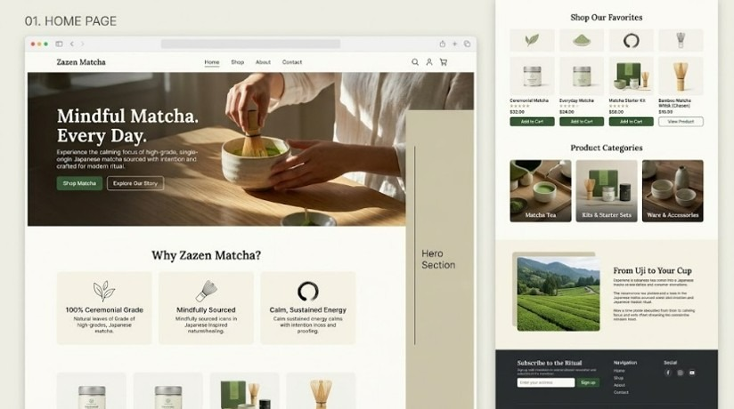
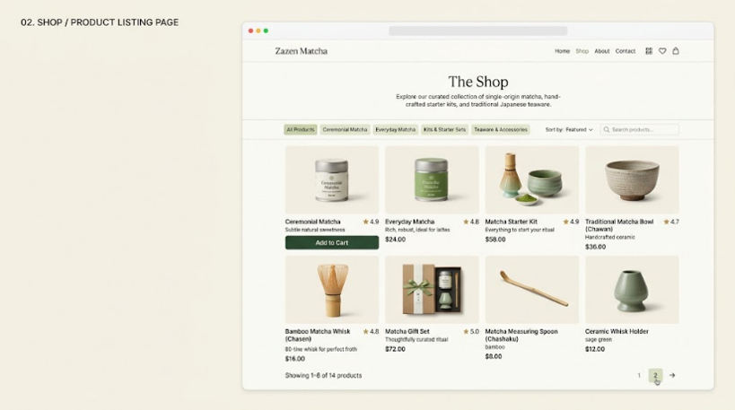

# Zazen Matcha & Tea Co.

A full-stack, bespoke e-commerce platform for single-origin Japanese ceremonial matcha, loose-leaf artisan teas, handcrafted teaware, and curated starter kits. Engineered from foundational web standards without Content Management Systems or monolithic frameworks.

Live deployment: [https://zazen-matcha.alwaysdata.net/](https://zazen-matcha.alwaysdata.net/)

---

## Overview

Zazen Matcha & Tea Co. is an e-commerce platform designed around the contemplative aesthetic of the traditional Japanese tea ceremony (*chado*). The concept takes inspiration from *zazen* (seated meditation) to translate mindfulness and intentional calm into an everyday digital retail experience.

The application addresses common frustrations in online specialty tea retail: ambiguous grading standards, lack of transparent provenance narratives, and clunky, generic storefronts. It provides an educational, distraction-free environment where customers can explore shade-grown tencha harvested in Uji, Kyoto, inspect handcrafted ceramic teaware, configure shopping bags with real-time stock feedback, and complete orders through an atomic checkout workflow.

Alongside the storefront, an isolated administrative console provides store operators with inventory CRUD controls, sales analytics, customer records, and order fulfillment logging.

---

## Preview

### Customer Storefront



*The storefront homepage introduces the brand narrative, value pillars, curated product categories, and in-studio menu.*



*The product catalog features faceted category filtering, keyword search, price indicators in South African Rand (ZAR), and stock badges.*

---

## Core Features

### Customer Storefront
- **Storytelling Homepage:** Editorial hero section, origin narrative from Uji hillside tea gardens, curated favorite collections, category showcase cards, in-studio tea bar demonstration menu, and interactive 3D Chawan vessel study.
- **Product Discovery & Filtering:** Filterable catalog across four retail categories (Ceremonial Matcha, Specialty Tea, Teaware & Accessories, Gift Sets) with instant category switching, keyword search, and pagination.
- **Product Details & Brewing Rituals:** Multi-angle photography galleries with thumbnail toggling, verified customer review metrics, live inventory badges, water temperature and steeping guidelines, and related product recommendations.
- **Session Shopping Bag:** Server-side price revalidation, quantity boundary clamping, instant line item recalculation, and persistent guest cart state managed via native PHP sessions.
- **Transactional Checkout:** One-page checkout capturing delivery details across South African provinces, validating contact fields, and processing orders through atomic database transactions.
- **Order Invoicing:** On-screen confirmation receipt displaying customer delivery snapshot, reference number, and itemized historical purchase prices.
- **Customer Account Management:** Registration, login, profile updates, password modification, and chronological personal order history protected by session authentication.
- **Studio Inquiries & Newsletter:** Studio inquiry form with input sanitization and footer newsletter subscription capture.

### Administrator Console
- **Operational Dashboard:** Real-time KPI summary cards (total products, active catalog count, registered customers, order counts, and gross sales revenue) with a live feed of recent orders.
- **Product Management:** Full CRUD interface for adding, editing, and toggling product status, including price and stock validation and automated low-stock warnings (items with 10 or fewer units).
- **Category Taxonomy Management:** Create and edit product categories with case-insensitive duplicate name checks and active product counts.
- **Order Oversight:** Chronological order ledger displaying historical shipping snapshots, line item breakdowns, and frozen purchase prices.
- **Customer Directory:** Searchable directory of registered customers with contact information and order history drilldown.
- **System Diagnostics:** Database connection health check verifying MariaDB connectivity and record counts.

---

## Design Approach

The interface follows a minimalist, editorial aesthetic rooted in Japanese *wabi-sabi* philosophy:
- **Palette:** Warm ivory surfaces (`#fbfcfb`), deep forest green accents (`#2d3a2e`), earthy stone borders (`#cad6cb`), and charcoal typography (`#1a201c`).
- **Typography:** Modern serif headings paired with clean, accessible sans-serif body typefaces for legible long-form reading and clear data hierarchy.
- **Layout Architecture:** Fluid CSS Grid containers with fractional units (`1fr`) that adapt gracefully without rigid pixel constraints.
- **Responsive Breakpoints:** Two primary media query thresholds:
  - *Tablet (960px):* Multi-column split views collapse into single vertical stacks, and sidebars revert to static positioning to prevent viewport overflow.
  - *Mobile (768px):* Product grids and metrics cards collapse to single-column layouts, touch targets expand to at least 44px, and global navigation transitions into an accessible drawer toggled via `#nav-toggle`.

---

## Technology Stack

- **Backend Runtime:** Native PHP 8 (Procedural and modular include architecture; no framework).
- **Database:** MariaDB 10.4 / MySQL (InnoDB storage engine, UTF-8 `utf8mb4_unicode_ci` encoding).
- **Database Abstraction:** PHP Data Objects (PDO) with prepared statements and exception handling.
- **Frontend Markup:** Semantic HTML5 (`header`, `main`, `article`, `section`, `nav`, `footer`) with WCAG 2.1 AA accessibility attributes (`aria-label`, `aria-hidden`).
- **Styling:** Custom CSS3 with CSS Custom Properties (design tokens), CSS Grid, and Flexbox (no Bootstrap, Tailwind, or CSS preprocessors).
- **Client-Side Scripting:** Vanilla JavaScript ES6+ wrapped in Immediately Invoked Function Expressions (IIFE) with progressive enhancement (no jQuery or frontend frameworks).
- **Server Environment:** Apache 2.4 under XAMPP for local development; Linux Apache on Alwaysdata Cloud with Let's Encrypt SSL/TLS for live hosting.

---

## System Architecture

```text
zazen-matcha/
├── admin/                      # Administrator back-office portal
│   ├── categories.php          # Category taxonomy CRUD
│   ├── customer-details.php    # Customer drilldown and order history
│   ├── customers.php           # Customer directory
│   ├── dashboard.php           # Real-time metrics and KPI dashboard
│   ├── login.php               # Admin authentication gate
│   ├── logout.php              # Secure admin session termination
│   ├── order-details.php       # Read-only order breakdown and shipping snapshot
│   ├── orders.php              # Chronological order fulfillment ledger
│   ├── product-add.php         # Product creation controller
│   ├── product-edit.php        # Product update controller
│   ├── products.php            # Product catalog inventory management
│   └── settings.php            # Live database connection diagnostic
├── css/
│   ├── admin.css               # Back-office portal styles
│   └── style.css               # Complete storefront design system
├── customer/                   # Customer-facing storefront controllers
│   ├── about.php               # Brand story and heritage
│   ├── account.php             # Customer profile and order history
│   ├── cart.php                # Session shopping bag management
│   ├── checkout.php            # Transactional order checkout
│   ├── contact.php             # Studio contact form
│   ├── drinks.php              # In-studio tea bar and beverage menu
│   ├── login.php               # Customer authentication
│   ├── logout.php              # Customer session termination
│   ├── order-confirmation.php  # Itemized order receipt
│   ├── product.php             # Single product details and gallery
│   ├── products.php            # Filterable product catalog
│   ├── register.php            # Customer account registration
│   ├── subscribe.php           # Newsletter subscription handler
│   └── tea.php                 # Specialty loose-leaf tea guide
├── database/
│   └── zazen_matcha.sql        # Normalized database schema and seed data
├── docs/                       # Academic reports, diagrams, and prototypes
│   ├── deliverable-2/          # Comprehensive Deliverable 2 report (PDF, HTML, MD)
│   ├── diagrams/               # System design models (Mermaid source)
│   │   └── rendered/           # Vector SVG diagrams (EERD, DFD, Use Case, Context)
│   └── prototypes/             # Customer mockups and administrative specifications
├── images/                     # Production photography library
│   ├── categories/             # Category showcase images
│   ├── gallery/                # Botanical and ingredient detail images
│   ├── products/               # Packaged retail products
│   ├── ritual-sequence/        # Matcha whisking demonstration frames
│   └── tea-bar/                # Handcrafted drinks photography
├── includes/                   # Shared server-side includes
│   ├── admin-auth.php          # Admin session authentication guard
│   ├── admin-footer.php        # Admin page footer
│   ├── admin-header.php        # Admin navigation bar and layout wrapper
│   ├── customer-auth.php       # Customer session authentication guard
│   ├── db.php                  # Singleton PDO database connection handler
│   ├── footer.php              # Storefront footer and script inclusions
│   ├── functions.php           # Sanitization, CSRF, URL routing, and helper utilities
│   └── header.php              # Storefront header, search, and navigation
├── js/
│   ├── chawan-sequence.js      # Scroll-driven ritual canvas animation
│   └── script.js               # Frontend UI utilities and drawer navigation
├── index.php                   # Storefront landing page
└── README.md                   # Project documentation
```

---

## Local Setup

### Prerequisites
- PHP 8.0 or newer with `pdo_mysql` and `openssl` extensions enabled.
- MariaDB 10.4+ or MySQL 8.0+ running with InnoDB support.
- Apache web server (standard XAMPP distribution recommended).

### Installation Steps

1. **Clone or Download the Repository:**
   Place the project folder into your web server document root:
   - *XAMPP on Windows:* `C:\xampp\htdocs\zazen-matcha`
   - *macOS / Linux:* `/var/www/html/zazen-matcha`

2. **Start Web and Database Services:**
   Launch the XAMPP Control Panel and start both **Apache** and **MySQL**.

3. **Import the Database Schema:**
   Open phpMyAdmin (`http://localhost/phpmyadmin/`) or run the MySQL command-line client:
   ```bash
   mysql -u root -p -e "CREATE DATABASE IF NOT EXISTS zazen_matcha CHARACTER SET utf8mb4 COLLATE utf8mb4_unicode_ci;"
   mysql -u root -p zazen_matcha < database/zazen_matcha.sql
   ```
   This creates the eight relational tables (`admins`, `customers`, `categories`, `products`, `orders`, `order_items`, `contact_messages`, `newsletter_subscribers`) and seeds initial sample records.

4. **Database Configuration:**
   The connection parameters are managed in `includes/db.php`. By default, it connects to standard local XAMPP settings:
   - Host: `127.0.0.1`
   - Database: `zazen_matcha`
   - Username: `root`
   - Password: `""` (blank)
   - Charset: `utf8mb4`

   To override these credentials without modifying core files, create an optional `config.php` file in the project root:
   ```php
   <?php
   define('DB_HOST', 'localhost');
   define('DB_NAME', 'zazen_matcha');
   define('DB_USER', 'your_username');
   define('DB_PASS', 'your_password');
   define('DB_CHARSET', 'utf8mb4');
   define('BASE_URL', '/zazen-matcha');
   ```
   *(The root `config.php` is ignored by `.gitignore` to prevent committing local or production credentials).*

5. **Access the Application:**
   - Storefront: `http://localhost/zazen-matcha/`
   - Admin Login: `http://localhost/zazen-matcha/admin/login.php`

6. **Default Local Development Accounts:**
   The initial database import (`database/zazen_matcha.sql`) provides two fictional fixture accounts for local demonstration:
   - **Store Administrator:** `admin@zazenmatcha.test` / `Admin123!`
   - **Customer Account:** `thabo@example.test` / `Customer123!`

   *Security Notice: These credentials are weak, fictional test fixtures intended solely for offline local development and evaluation. They are not active on the live public deployment and must never be used in a production environment.*

---

## Security Notes

The application incorporates defensive programming patterns suited for educational and small-scale web projects:
- **SQL Injection Defense:** All database queries utilize PDO prepared statements with parameter binding. Emulated prepares are disabled (`PDO::ATTR_EMULATE_PREPARES => false`).
- **Cross-Site Scripting (XSS) Mitigation:** Dynamic output values rendered in HTML views are escaped using `htmlspecialchars(..., ENT_QUOTES | ENT_SUBSTITUTE, 'UTF-8')` via the helper function `e()`.
- **Cross-Site Request Forgery (CSRF) Tokens:** Modifying POST forms (such as cart updates, checkout, login, registration, and administrative CRUD) validate cryptographically random session tokens using constant-time string comparison (`hash_equals()`).
- **Password Security:** Authentication credentials are stored as Bcrypt hashes generated with native PHP `password_hash()` and verified with `password_verify()`. Plaintext passwords are never stored or logged.
- **Session Isolation:** Customer sessions and administrative sessions are maintained independently with dedicated authorization guards (`require_customer_login()` and `require_admin_login()`), and session identifiers are regenerated upon login.
- **Concurrency & Row Locking:** Checkout processing uses atomic transactions with pessimistic row-locking (`SELECT ... FOR UPDATE`) to prevent overselling inventory when multiple users checkout simultaneously.

*Note:* While these controls address fundamental web application risks, this project was developed for academic demonstration and has not undergone third-party penetration testing.

---

## Project Status & Limitations

In accordance with academic transparency, the boundaries of the current implementation are explicitly defined:

### Implemented
- Full customer retail browsing, faceted category filtering, keyword search, and pagination.
- Multi-angle product detail galleries and preparation guides.
- Session-based cart with price revalidation and progressive-enhancement steppers.
- Concurrency-safe checkout with simulated payment tenders (instant Simulated Card authorization and manual Bank Transfer EFT instructions).
- Customer account registration, profile management, password updates, and order history.
- Administrative dashboard with real-time KPI metrics and product/category CRUD controls.
- Read-only order ledger displaying customer shipping snapshots and historical item pricing.
- Public deployment on Alwaysdata with active SSL/TLS.

### Proposed Future Enhancements (Deliverable 3 Scope)
- **Administrative Order Status Transitions:** The order details view (`admin/order-details.php`) currently functions as an immutable, read-only audit log. Mutating fulfillment status (`pending` to `shipped` or `delivered`) and payment status from the web interface is proposed for the next milestone.
- **Live Payment Gateway:** Connecting the checkout workflow to a live payment service provider (e.g. PayFast or Stripe) via sandbox API credentials and webhook verification.
- **Automated Email Dispatch:** Integrating an SMTP email transport or transactional email API (such as PHPMailer via SendGrid) to dispatch order invoices and shipping updates.

---

## Academic Context

This repository represents the practical implementation and documentation for **Deliverable 2** of the **Web Development and e-Commerce Technologies (ITECA3-34)** module at **Eduvos Higher Education** (South Africa).

The assignment brief requires engineering a full-stack, database-driven e-commerce platform from foundational web standards without using third-party Content Management Systems (CMS) or pre-built commercial templates. All source code, schema designs, visual models, and documentation were produced to demonstrate core software engineering and relational database competencies.

---

## License

This project was developed for educational purposes as part of the Eduvos academic curriculum. All source code is available under the MIT License. Photography and brand assets are used strictly for academic prototype demonstration.
