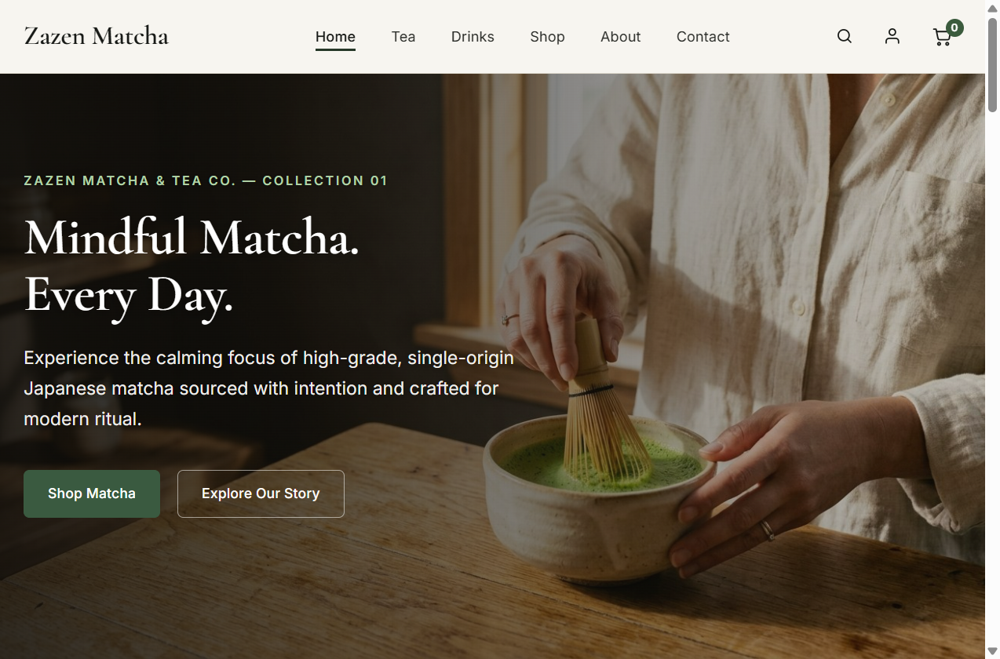
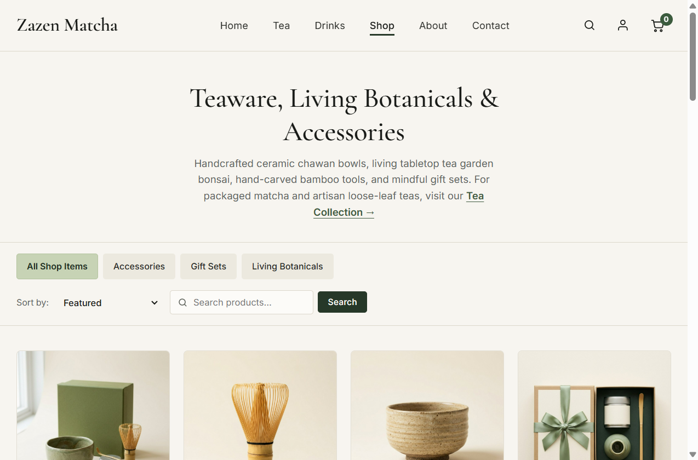
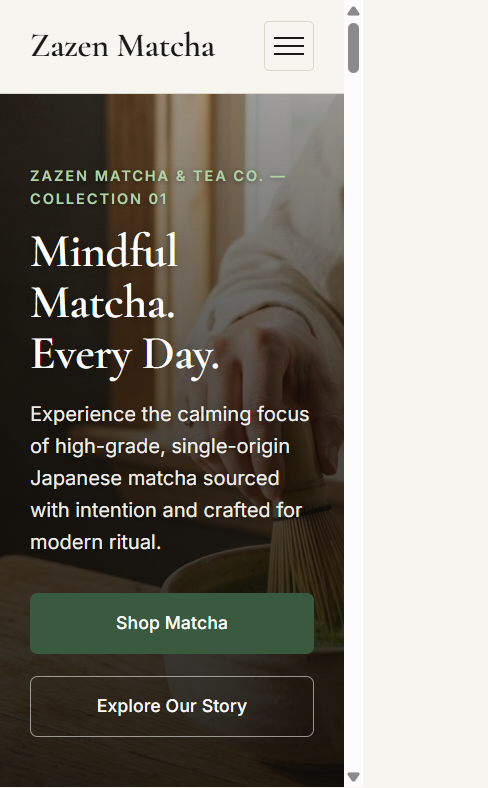
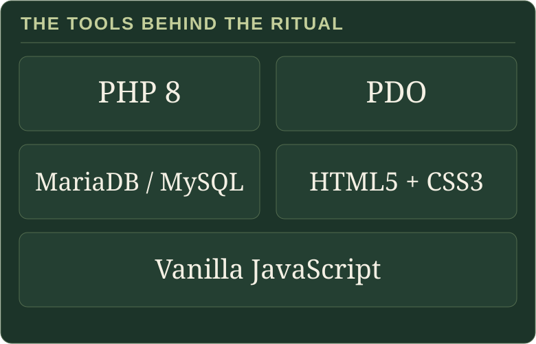

<h1 align="center"></h1>

<p align="center"></p>

<p align="center"><sub>A slow loop, composed from six photographed moments in the matcha ritual.</sub></p>

<p align="center">
  <a href="https://zazen-matcha.alwaysdata.net/"><strong>ENTER THE LIVE STOREFRONT ↗</strong></a>
  <br />
  <sub>ITECA3-34 · WEB DEVELOPMENT &amp; E-COMMERCE · DELIVERABLE 02</sub>
</p>

<p align="center"></p>

## The project

Zazen Matcha & Tea Co. is a student-built e-commerce experience for Japanese matcha, loose-leaf tea, teaware, and gift sets. A calm, editorial storefront meets the practical engineering beneath it: a PHP application, relational data, customer accounts, order flows, and a separate store console.

The visual language takes its cue from the tea ritual: forest green, warm ivory, botanical details, and unhurried photography. The project was developed for **Deliverable 2** of **ITECA3-34: Web Development and e-Commerce Technologies** at **Eduvos**.

<p align="center"></p>

## A window into the store

These are browser captures of the live application, not design mockups.

### 01 · The storefront



*The opening frame: editorial photography, a considered product story, and a direct path into the shop.*

### 02 · The collection



*A real catalogue view, with category selection, sorting, search, and product photography.*

### 03 · A smaller screen

<p align="center"></p>

<p align="center"><sub>The same storefront at a 390 px mobile viewport.</sub></p>

<p align="center"></p>

## Built for the ritual

- **Discover** — browse by category, search the catalogue, paginate results, and explore product galleries, stock availability, and preparation guidance.
- **Shop** — manage a session-based cart; checkout revalidates current prices and stock and commits orders and inventory updates in a database transaction.
- **Connect** — register, sign in, manage account details, review order history, send a studio inquiry, and subscribe to the newsletter.
- **Steward** — use the administration console to review store metrics and orders, maintain products and categories, browse customers, and inspect order details.

> **Payment note:** checkout offers simulated card processing and bank-transfer instructions. There is no live payment-gateway integration.

## The materials

<p align="center"></p>

The application uses native PHP pages and shared includes, PDO for database access, semantic HTML, custom CSS, and vanilla JavaScript. Apache serves the application locally; the database schema targets MariaDB/MySQL.

## In the repository

```text
admin/       Store operations and administration
customer/    Catalogue, product, cart, account, and checkout pages
includes/    Shared PHP helpers, authentication, and database access
database/    Schema and seed data
css/         Storefront and administration styles
js/          Frontend interactions and the chawan ritual sequence
images/      Store and brand photography
docs/        Assignment materials, diagrams, prototypes, and README artwork
```

## Run locally

**Requirements:** PHP 8 or newer with `pdo_mysql`, MariaDB 10.4+ or MySQL 8.0+, and Apache. XAMPP is suitable for local development.

1. Place or clone the project in the Apache document root, for example `C:\xampp\htdocs\ZAZEN-MATCHA`.
2. Start Apache and MySQL/MariaDB.
3. Create the database with the character set and collation used by the schema:

   ```sql
   CREATE DATABASE zazen_matcha
     CHARACTER SET utf8mb4
     COLLATE utf8mb4_unicode_ci;
   ```

4. Import [`database/zazen_matcha.sql`](database/zazen_matcha.sql) with phpMyAdmin or a MySQL-compatible client.
5. The PDO connection is configured in [`includes/db.php`](includes/db.php). For machine-specific settings, use the optional root `config.php` override; it is ignored by Git. Keep local credentials private.
6. Visit `http://localhost/ZAZEN-MATCHA/`.

<p align="center"></p>

<p align="center"></p>

<p align="center"><a href="https://zazen-matcha.alwaysdata.net/"><strong>Visit the live store</strong></a></p>
