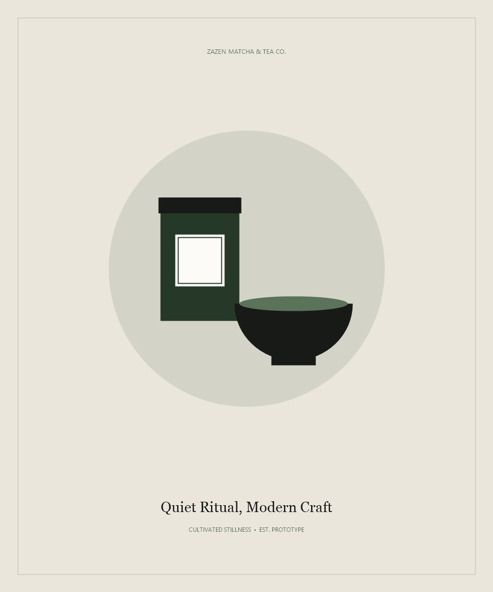

# Zazen Matcha & Tea Co.

> A considered online tea shop, built as a full-stack web development project.



**Zazen Matcha & Tea Co.** is an academic e-commerce application for exploring Japanese matcha, loose-leaf tea, teaware, and gift sets. The project brings together a customer storefront, account and checkout flows, and a separate store administration area, using native web technologies rather than a content-management system or application framework.

**Live website:** [zazen-matcha.alwaysdata.net](https://zazen-matcha.alwaysdata.net/)

---

## The experience

The visual direction draws on the quiet, tactile character of a tea ritual: matcha greens, warm neutral surfaces, editorial typography, and generous imagery. The storefront combines product discovery with practical shopping and brewing information.


*Customer storefront design prototype.*

## Features

### Customer storefront

- Browse the product catalogue by category, search by keyword, and move through paginated results.
- View product details, image galleries, stock availability, preparation guidance, and related products.
- Add items to a session-based shopping cart; cart and checkout re-check current prices and stock.
- Submit an order through a validated checkout flow. Order creation and stock updates are handled in a database transaction.
- Create an account, sign in, update account details, and review order history.
- Send a studio inquiry or subscribe to the newsletter.

### Administration

- Review store metrics and recent orders from the dashboard.
- Create and update products and categories, including product pricing, stock, and status.
- Browse customer records and inspect order details and purchase snapshots.
- Check database connectivity from the diagnostics page.

> Checkout payment options are simulated card processing and bank-transfer instructions. The project does not integrate a live payment gateway.

## Technology

- **Server:** PHP 8+, using native PHP includes and controllers
- **Database:** MariaDB or MySQL, accessed through PDO
- **Frontend:** Semantic HTML, custom CSS, and vanilla JavaScript
- **Local web server:** Apache (XAMPP is the documented Windows development setup)

## Project layout

```text
admin/       Store administration pages
customer/    Storefront, account, cart, and checkout pages
database/    SQL schema and seed data
includes/    Shared PHP helpers, authentication, and database connection
css/         Storefront and administration styles
js/          Frontend interactions
images/      Product, category, and brand imagery
index.php    Storefront entry point
```

## Run locally

### Requirements

- PHP 8 or newer with the PDO MySQL extension enabled
- MariaDB 10.4+ or MySQL 8.0+
- Apache; XAMPP is suitable for local development

### Setup

1. Place or clone the repository into the Apache document root. For XAMPP, that is commonly `C:\xampp\htdocs\ZAZEN-MATCHA`.
2. Start Apache and MySQL/MariaDB from the XAMPP Control Panel.
3. Create a database named `zazen_matcha` using `utf8mb4` with the `utf8mb4_unicode_ci` collation.
4. Import [`database/zazen_matcha.sql`](database/zazen_matcha.sql) using phpMyAdmin or the MySQL command-line client.
5. The connection defaults are defined in [`includes/db.php`](includes/db.php). If your local database needs different settings, use a root `config.php` override; it is excluded by `.gitignore`. Keep local credentials private and do not commit that file.
6. Open `http://localhost/ZAZEN-MATCHA/` in your browser.

## Academic context

This project was developed for **Deliverable 2** of **ITECA3-34: Web Development and e-Commerce Technologies** at **Eduvos Higher Education** in South Africa. It demonstrates the design and implementation of a database-driven e-commerce application using foundational web technologies.
