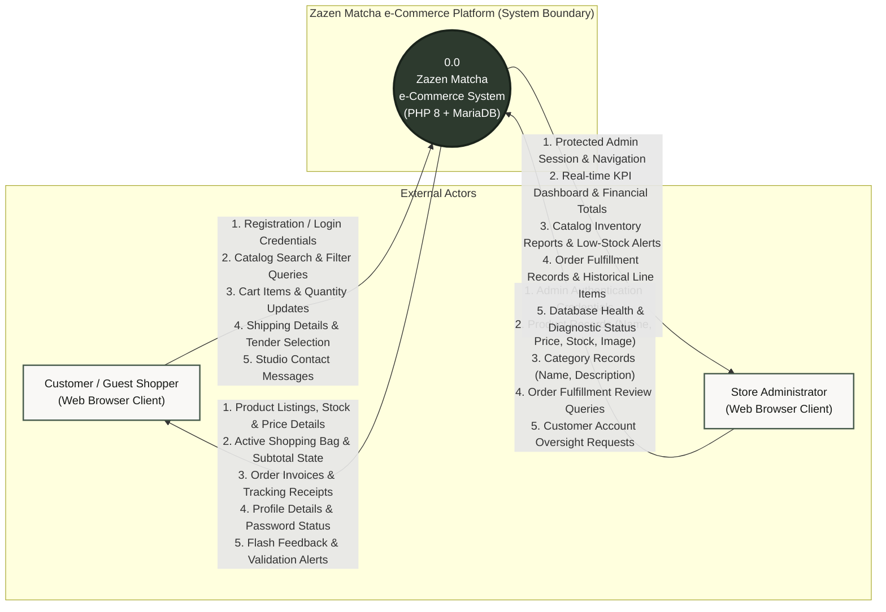

# System Context Diagram (Level 0 DFD)
**Project:** Zazen Matcha & Tea Co. — e-Commerce Platform  
**Course:** Eduvos ITECA3-34 Web Development and e-Commerce Technologies (Deliverable 2)  
**Document:** System Design Documentation — Context Diagram  
**Source Baseline:** `C:\xampp\htdocs\ZAZEN-MATCHA`

---

## 1. Architectural Boundary & External Interfaces

The System Context Diagram defines the high-level boundary of the Zazen Matcha e-Commerce web application and illustrates all information flows exchanged between the core software platform and external actors.

### Critical Verification Note Regarding Payment Processing:
In strict conformance with the actual codebase and assignment requirements:
* **No External Payment Gateway Exists:** The platform does **not** connect to an external payment processor (such as PayFast, Stripe, or PayPal).
* **Simulated Prototype Architecture:** Payment processing is executed internally via simulated tender options (`Simulated Card` with instant approval, and manual `Bank Transfer (EFT)` instructions). All transaction flows reside strictly inside the application boundary.

---

## 2. Visual Context Diagram (Mermaid)

---

## 3. Data Flow Specification

### 3.1 Customer / Guest Shopper Entity Flows
* **Inputs to System:**
  1. *Registration & Authentication Credentials:* Customer name, email, contact telephone, password, and CSRF token.
  2. *Catalog Search & Filter Queries:* Text keywords (`?search=`), category taxonomy identifiers (`?category=`), and pagination requests.
  3. *Shopping Cart Operations:* Product identifiers, quantity additions, quantity adjustments, item removals, and cart flushes.
  4. *Checkout Information:* Recipient full name, street delivery address, city, South African province, postal code, and chosen tender method (`Simulated Card` or `Bank Transfer (EFT)`).
  5. *Studio Inquiries:* Contact message submissions (sender name, email, subject, inquiry text).
* **Outputs to Customer:**
  1. *Product & Editorial Data:* Responsive HTML views of ceremonial and everyday matcha listings, stoneware chawans, whisks, prices in ZAR, and live stock-level indicators.
  2. *Cart Calculation:* Real-time subtotal, shipping cost (R 0.00 standard), and total item count.
  3. *Order Invoices & Confirmation:* Unique order reference (`order_id`), timestamped confirmation screen, and line item receipts.
  4. *Profile & Security Feedback:* Form validation error summaries, CSRF security rejections, and success flash messages.

### 3.2 Store Administrator Entity Flows
* **Inputs to System:**
  1. *Administrator Credentials:* Administrative email and password verified against the isolated `admins` table.
  2. *Product Management Mutations:* Creation, editing, price adjustments, stock increments/decrements, and active/inactive status toggles.
  3. *Category Taxonomy Mutations:* Creation and description edits for product classification.
  4. *Operational Drilldowns:* Navigation to specific order breakdowns (`admin/order-details.php?id=X`) and customer profiles.
* **Outputs to Administrator:**
  1. *Executive Metrics:* Dynamic dashboard counters aggregating Total Products, Active Products, Total Customers, Total Orders, Pending Orders, and Gross Revenue.
  2. *Operational Tables:* Paginated listings of all products, stock quantities (with `< 10` low-stock flags), categories with product counts, and recent orders.
  3. *Order Records:* Customer shipping snapshots, order timestamps, and purchased item historical pricing.
  4. *Diagnostic Information:* Database connection status and table row counts.
