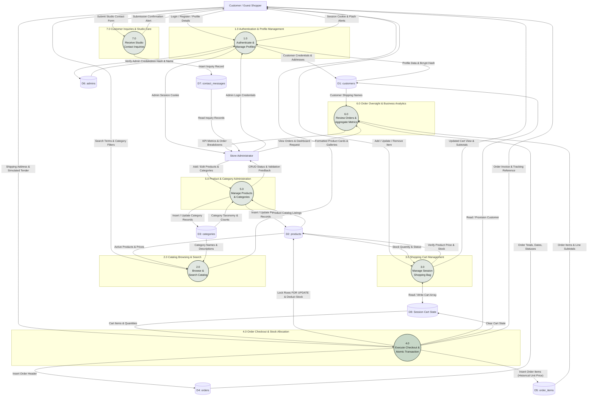

# Level 1 Data Flow Diagram (DFD)
**Project:** Zazen Matcha & Tea Co. — e-Commerce Platform  
**Course:** Eduvos ITECA3-34 Web Development and e-Commerce Technologies (Deliverable 2)  
**Document:** System Design Documentation — Level 1 DFD  
**Source Baseline:** `C:\xampp\htdocs\ZAZEN-MATCHA`

---

## 1. Process Decomposition & Architectural Scope

The Level 1 Data Flow Diagram decomposes the primary system boundary (Process 0.0) into seven concrete, functional subprocesses mapping directly to the actual PHP controllers and MariaDB data stores.

### Implemented Subprocesses:
1. **1.0 User Authentication & Profile Management:** Handles customer registration, credential verification, session creation, profile updating, and administrative login.
2. **2.0 Catalog Browsing & Search:** Serves active products, executes keyword search, filters by taxonomy category, and presents single product galleries.
3. **3.0 Shopping Cart Management:** Controls session-based shopping bag items, enforces real-time stock limits, and computes dynamic line subtotals.
4. **4.0 Order Checkout & Stock Allocation:** Collects shipping details, verifies stock via row locks (`FOR UPDATE`), creates orders and line items inside a PDO transaction, and decrements inventory.
5. **5.0 Product & Category Administration:** Provides catalog CRUD operations, category uniqueness checks, and stock level maintenance for store administrators.
6. **6.0 Order Oversight & Business Analytics:** Computes dashboard KPI sales metrics and renders detailed fulfillment records.
7. **7.0 Customer Inquiries & Studio Care:** Validates and stores incoming contact form messages.

---

## 2. Visual Level 1 DFD (Mermaid)

---

## 3. Data Store Mapping

| Data Store | Schema Table | Storage Mechanism | Access Mode | Description |
| :--- | :--- | :--- | :--- | :--- |
| **D1: Customers** | `customers` | MariaDB InnoDB | Read / Write | Stores customer profile records, delivery addresses, and Bcrypt password hashes. |
| **D2: Products** | `products` | MariaDB InnoDB | Read / Write | Stores catalog items, pricing in ZAR, inventory stock quantities, image filenames, and active status. |
| **D3: Categories** | `categories` | MariaDB InnoDB | Read / Write | Stores taxonomy classifications (`Matcha`, `Accessories`, `Gift Sets`). |
| **D4: Orders** | `orders` | MariaDB InnoDB | Read / Write | Stores transactional order headers, immutable shipping address snapshots, and simulated payment methods. |
| **D5: Order Items** | `order_items` | MariaDB InnoDB | Read / Write | Stores purchased line items, quantities, line subtotals, and frozen historical `unit_price`. |
| **D6: Admins** | `admins` | MariaDB InnoDB | Read-Only (Auth) | Stores isolated administrative credentials and Bcrypt password hashes (e.g. local development test fixture `admin@zazenmatcha.test`). |
| **D7: Contact Messages** | `contact_messages` | MariaDB InnoDB | Read / Write | Stores customer feedback and studio inquiries submitted through the contact form. |
| **D8: Session Cart** | `$_SESSION['cart']` | PHP Server RAM / File | Read / Write | Ephemeral session storage holding product IDs and requested quantities prior to checkout. |
