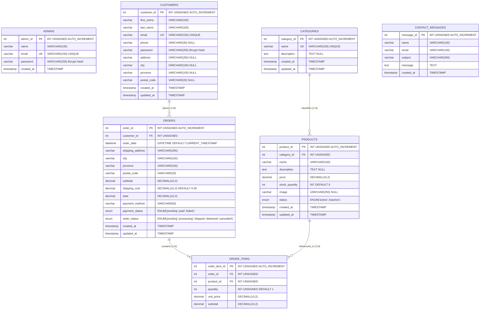

# Enhanced Entity Relationship Diagram (EERD)
**Project:** Zazen Matcha & Tea Co. — e-Commerce Platform  
**Course:** Eduvos ITECA3-34 Web Development and e-Commerce Technologies (Deliverable 2)  
**Document:** System Design Documentation — EERD  
**Database:** `zazen_matcha` (MySQL / MariaDB 10.4 InnoDB, UTF-8 mb4)  
**Source Baseline:** `database/zazen_matcha.sql`

---

## 1. Visual Entity Relationship Model (Mermaid)

---

## 2. Cardinality & Relationship Breakdown

### 2.1 Categories to Products (1 : N)
* **Parent Entity:** `categories` (`category_id`)
* **Child Entity:** `products` (`category_id`)
* **Cardinality:** Exactly 1 Category to Zero, One, or Many Products ($1 : 0..\text{N}$).
* **Foreign Key:** `fk_products_category`
* **Referential Action:** `ON DELETE RESTRICT`, `ON UPDATE CASCADE`.
* **Business Rule:** A product category cannot be deleted from the database if active or inactive products are currently assigned to it. This prevents orphaned catalog items and preserves inventory reporting.

### 2.2 Customers to Orders (1 : N)
* **Parent Entity:** `customers` (`customer_id`)
* **Child Entity:** `orders` (`customer_id`)
* **Cardinality:** Exactly 1 Customer to Zero, One, or Many Orders ($1 : 0..\text{N}$).
* **Foreign Key:** `fk_orders_customer`
* **Referential Action:** `ON DELETE RESTRICT`, `ON UPDATE CASCADE`.
* **Business Rule:** Customer accounts cannot be deleted if past order records exist. This maintains legal transaction history, auditing compliance, and financial records. For guest checkout, a customer row is created/linked automatically.

### 2.3 Orders to Order Items (1 : N)
* **Parent Entity:** `orders` (`order_id`)
* **Child Entity:** `order_items` (`order_id`)
* **Cardinality:** Exactly 1 Order to One or Many Order Items ($1 : 1..\text{N}$).
* **Foreign Key:** `fk_order_items_order`
* **Referential Action:** `ON DELETE RESTRICT`, `ON UPDATE CASCADE`.
* **Business Rule:** Every purchase order must contain at least one line item. Order line items cannot be deleted independently of an authorized administrative process, preventing financial imbalance.

### 2.4 Products to Order Items (1 : N)
* **Parent Entity:** `products` (`product_id`)
* **Child Entity:** `order_items` (`product_id`)
* **Cardinality:** Exactly 1 Product to Zero, One, or Many Order Items ($1 : 0..\text{N}$).
* **Foreign Key:** `fk_order_items_product`
* **Referential Action:** `ON DELETE RESTRICT`, `ON UPDATE CASCADE`.
* **Business Rule:** A product cannot be dropped or deleted from the database once it has been purchased in an order. To retire a product from the public storefront, administrators change its `status` from `active` to `inactive`.

---

## 3. Enhanced Design Decisions & Financial Integrity

1. **Historical Price Preservation (`order_items.unit_price`):**
   * The `order_items` entity explicitly stores `unit_price` as a snapshot taken at the exact instant the transaction occurred.
   * If an administrator later updates the product's catalog price in `products.price`, past order totals and customer invoices remain mathematically consistent and unaltered.

2. **Shipping Address Snapshot:**
   * The `orders` entity duplicates address attributes (`shipping_address`, `city`, `province`, `postal_code`) rather than relying exclusively on a live join to `customers`.
   * If a customer moves and updates their profile in `customers`, historical fulfillment records reflect the exact address where the parcel was originally delivered.

3. **Standalone Operational Entities:**
   * **`admins`:** Stored in a separate table completely disconnected from `customers` to prevent privilege-escalation vulnerabilities and ensure administrative sessions are strictly isolated.
   * **`contact_messages`:** Captures customer feedback and wholesale studio inquiries without forcing account creation or introducing foreign key dependencies.
