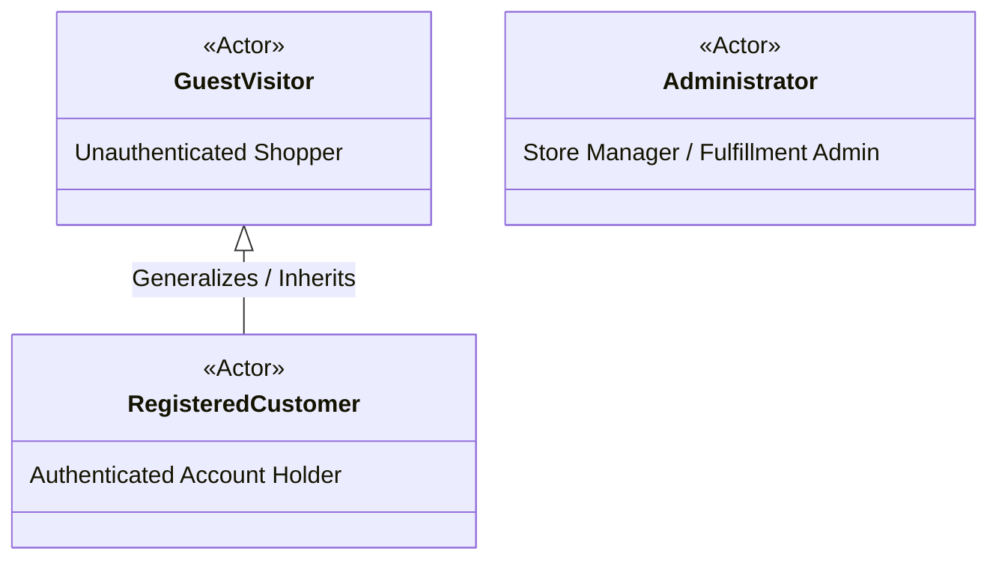
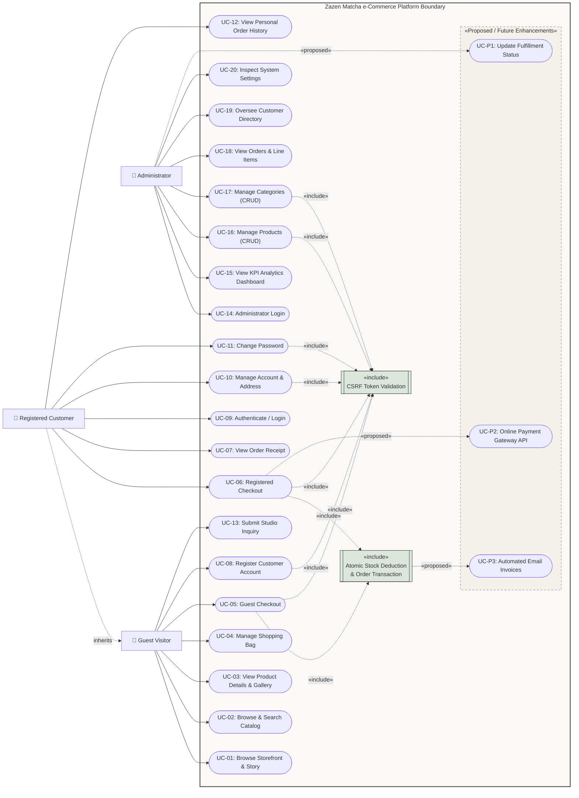

# UML Use Case Diagram & System Specifications
**Project:** Zazen Matcha & Tea Co. — e-Commerce Platform  
**Course:** Eduvos ITECA3-34 Web Development and e-Commerce Technologies (Deliverable 2)  
**Document:** System Design Documentation — Use Case Model  
**Source Baseline:** `C:\xampp\htdocs\ZAZEN-MATCHA`

---

## 1. Actor Hierarchy & System Scope

The Use Case Model articulates the functional interactions supported by the Zazen Matcha e-Commerce platform across three primary human actors:

* **Guest Visitor:** An unauthenticated shopper who can freely explore the storefront, browse and filter products, manage a session shopping cart, submit contact inquiries, or proceed through guest checkout without prior registration.
* **Registered Customer:** An authenticated account holder who inherits all visitor capabilities and gains access to saved profile maintenance, pre-filled checkout, password management, and personal order history.
* **Administrator:** An authorized manager who authenticates via an independent portal to supervise sales metrics, oversee the product and category catalog, inspect customer orders, and view database diagnostics.

---

## 2. Visual UML Use Case Diagram (Mermaid)

---

## 3. Use Case Specifications & Functional Status

### 3.1 Implemented Storefront & Customer Use Cases

| ID | Use Case Name | Primary Actor | Implementation Path | Verification Status |
| :--- | :--- | :--- | :--- | :--- |
| **UC-01** | Browse Storefront & Story | Guest / Customer | `index.php`, `customer/about.php` | **VERIFIED (Live HTTP 200)** |
| **UC-02** | Browse & Search Catalog | Guest / Customer | `customer/products.php` | **VERIFIED (Live HTTP 200)** |
| **UC-03** | View Product Details | Guest / Customer | `customer/product.php` | **VERIFIED (Source Audit)** |
| **UC-04** | Manage Shopping Bag | Guest / Customer | `customer/cart.php` | **VERIFIED (Source Audit)** |
| **UC-05** | Guest Checkout | Guest | `customer/checkout.php` | **VERIFIED (Source Audit)** |
| **UC-06** | Registered Checkout | Customer | `customer/checkout.php` | **VERIFIED (Source Audit)** |
| **UC-07** | View Order Receipt | Guest / Customer | `customer/order-confirmation.php` | **VERIFIED (Source Audit)** |
| **UC-08** | Register Account | Guest | `customer/register.php` | **VERIFIED (Live HTTP 200)** |
| **UC-09** | Authenticate / Login | Customer | `customer/login.php` | **VERIFIED (Live HTTP 200)** |
| **UC-10** | Manage Profile & Address | Customer | `customer/account.php` | **VERIFIED (Source Audit)** |
| **UC-11** | Change Password | Customer | `customer/account.php` | **VERIFIED (Source Audit)** |
| **UC-12** | View Personal Order History | Customer | `customer/account.php` | **VERIFIED (Source Audit)** |
| **UC-13** | Submit Studio Inquiry | Guest / Customer | `customer/contact.php` | **VERIFIED (Live HTTP 200)** |

### 3.2 Implemented Administrator Use Cases

| ID | Use Case Name | Primary Actor | Implementation Path | Verification Status |
| :--- | :--- | :--- | :--- | :--- |
| **UC-14** | Administrator Login | Administrator | `admin/login.php` | **VERIFIED (Live HTTP 200)** |
| **UC-15** | View KPI Analytics Dashboard | Administrator | `admin/dashboard.php` | **VERIFIED (Source Audit)** |
| **UC-16** | Manage Products (CRUD) | Administrator | `admin/products.php`, `product-add.php`, `product-edit.php` | **VERIFIED (Source Audit)** |
| **UC-17** | Manage Categories (CRUD) | Administrator | `admin/categories.php`, `category-add.php`, `category-edit.php` | **VERIFIED (Source Audit)** |
| **UC-18** | View Orders & Line Items | Administrator | `admin/orders.php`, `order-details.php` | **VERIFIED (Source Audit)** |
| **UC-19** | Oversee Customer Directory | Administrator | `admin/customers.php`, `customer-details.php` | **VERIFIED (Source Audit)** |
| **UC-20** | Inspect System Settings | Administrator | `admin/settings.php` | **VERIFIED (Source Audit)** |

### 3.3 Proposed / Future Enhancements (Distinct from Current Baseline)

| ID | Proposed Use Case | Target Actor | Architectural Description | Reason Not in Current Baseline |
| :--- | :--- | :--- | :--- | :--- |
| **UC-P1** | Update Order Fulfillment Status | Administrator | Allow administrators to update `orders.order_status` (`pending` $\to$ `processing` $\to$ `shipped` $\to$ `delivered`) and `orders.payment_status` (`pending` $\to$ `paid`). | Currently `admin/order-details.php` is strictly read-only; identified as the highest priority implementation advancement. |
| **UC-P2** | Online Payment Gateway | Customer | Connect checkout to an external PCI-compliant payment gateway (e.g. PayFast or Stripe). | Current prototype relies exclusively on simulated card and manual EFT instructions per academic assignment scope. |
| **UC-P3** | Automated Email Invoices | Customer / Admin | Trigger transactional SMTP dispatch of HTML order receipts and status alerts. | Current prototype displays web confirmations via `order-confirmation.php` without active local SMTP mailer configuration. |
