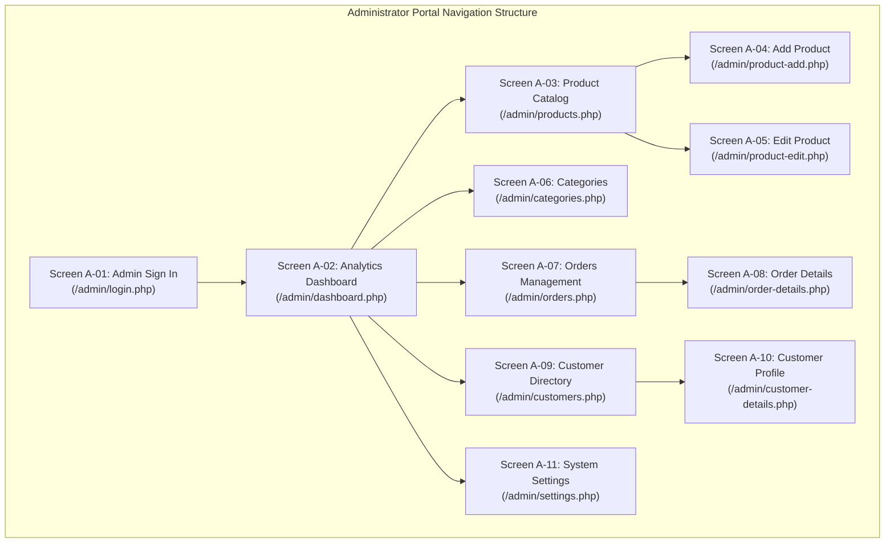

# Administrator Management Console Prototype Documentation
**Project:** Zazen Matcha & Tea Co. — e-Commerce Platform  
**Course:** Eduvos ITECA3-34 Web Development and e-Commerce Technologies (Deliverable 2)  
**Deliverable Component:** Admin Website Prototype (6 Marks)  
**Location:** `docs/prototypes/admin/`

---

## 1. Executive Summary & Administrative Purpose

The Zazen Matcha Administrator Management Console prototype establishes the information architecture, visual layout, and administrative workflows required to supervise store operations. The interface is engineered with a cohesive minimalist aesthetic matching the customer storefront, utilizing a dedicated dark-forest accent palette, clear typography, and responsive data tables.

### Key Objectives:
1. **Executive Oversight:** Provide real-time visibility into business performance (total products, active inventory, registered customers, order counts, and gross sales revenue in ZAR).
2. **Catalog & Inventory Control:** Enable full CRUD lifecycle management over tea products and category classifications, including real-time low-stock alerting (`stock_quantity <= 10`).
3. **Fulfillment Tracking:** Display chronological order logs, customer shipping snapshots, and line item financial breakdowns.
4. **Session Isolation:** Maintain strict separation between administrative privileges and customer accounts to prevent cross-contamination of sessions or shopping bags.

---

## 2. Implemented Baseline vs. Proposed Functionality

In accordance with strict academic integrity, this prototype documentation explicitly delineates **features verified in the codebase** from **proposed future enhancements**:

| Module | Sub-Feature | Implementation Status | Functional Description & Code Location |
| :--- | :--- | :---: | :--- |
| **Authentication** | Admin Login | **IMPLEMENTED** | Isolated credentials checked against `admins` table with Bcrypt verification in [`admin/login.php`](file:///c:/xampp/htdocs/ZAZEN-MATCHA/admin/login.php). |
| **Authentication** | Session Isolation | **IMPLEMENTED** | Dedicated auth guard [`require_admin_login()`](file:///c:/xampp/htdocs/ZAZEN-MATCHA/includes/admin-auth.php) protecting all `/admin/*` routes. |
| **Dashboard** | Sales & Metric KPIs | **IMPLEMENTED** | Dynamic PDO aggregations (Products, Customers, Orders, Revenue) in [`admin/dashboard.php`](file:///c:/xampp/htdocs/ZAZEN-MATCHA/admin/dashboard.php). |
| **Dashboard** | Recent Orders Feed | **IMPLEMENTED** | Real-time display of the 5 most recent customer orders with status badges. |
| **Products** | Catalog Listing | **IMPLEMENTED** | Paginated table with category joins and low-stock indicators in [`admin/products.php`](file:///c:/xampp/htdocs/ZAZEN-MATCHA/admin/products.php). |
| **Products** | Add / Edit Product | **IMPLEMENTED** | Dynamic category select, price/stock validation, and CSRF protection in [`admin/product-add.php`](file:///c:/xampp/htdocs/ZAZEN-MATCHA/admin/product-add.php) and [`admin/product-edit.php`](file:///c:/xampp/htdocs/ZAZEN-MATCHA/admin/product-edit.php). |
| **Categories** | Taxonomy CRUD | **IMPLEMENTED** | List, Add, and Edit with case-insensitive duplicate name checks in [`admin/categories.php`](file:///c:/xampp/htdocs/ZAZEN-MATCHA/admin/categories.php). |
| **Customers** | Customer Directory | **IMPLEMENTED** | Newest-first customer list with phone, email, and order counts in [`admin/customers.php`](file:///c:/xampp/htdocs/ZAZEN-MATCHA/admin/customers.php). |
| **Customers** | Customer Drilldown | **IMPLEMENTED** | Profile view with address snapshot and full order history in [`admin/customer-details.php`](file:///c:/xampp/htdocs/ZAZEN-MATCHA/admin/customer-details.php). |
| **Orders** | Orders Listing | **IMPLEMENTED** | Chronological order feed with payment and fulfillment badges in [`admin/orders.php`](file:///c:/xampp/htdocs/ZAZEN-MATCHA/admin/orders.php). |
| **Orders** | Order Breakdown | **IMPLEMENTED** | Historical shipping address and frozen `unit_price` line items in [`admin/order-details.php`](file:///c:/xampp/htdocs/ZAZEN-MATCHA/admin/order-details.php). |
| **Orders** | **Status Transition Mutation** | **PROPOSED** | *Identified Functional Gap:* Updating `order_status` (`pending` $\to$ `processing` $\to$ `shipped` $\to$ `delivered`) and `payment_status` (`pending` $\to$ `paid`). The current page is read-only. |
| **Settings** | Database Health Check | **IMPLEMENTED** | Live `SELECT 1` ping and record summary verification in [`admin/settings.php`](file:///c:/xampp/htdocs/ZAZEN-MATCHA/admin/settings.php). |
| **Reporting** | CSV Export | **PROPOSED** | Bulk exporting order journals and inventory counts to CSV/Excel for external accounting. |

---

## 3. Prototype Screen Inventory & Interface Architecture

### Screen A-01: Administrator Authentication Portal ([`admin/login.php`](file:///c:/xampp/htdocs/ZAZEN-MATCHA/admin/login.php))
* **Header & Banner:** Minimalist top bar with *Return to Customer Storefront* link; hero banner explaining authorized management console access.
* **Layout:** Split two-column desktop presentation:
  * *Left:* Clean credential form (Email input, Password input, CSRF hidden token, primary button *Sign In to Dashboard*).
  * *Right:* System overview panel explaining catalogue control, fulfillment tracking, and isolated session safeguards.
* **Security:** Enforces CSRF validation and timing-attack resilient password verification via `password_verify()`.

### Screen A-02: Executive Analytics Dashboard ([`admin/dashboard.php`](file:///c:/xampp/htdocs/ZAZEN-MATCHA/admin/dashboard.php))
* **Header Bar:** Displays current signed-in administrator name (*"Signed in as: Zazen Admin"*), with direct links to core management areas.
* **KPI Metrics Grid:** 4-card responsive metrics grid:
  1. *Total Catalog Products* (Active count subtitle).
  2. *Total Registered Customers*.
  3. *Total Orders* (Pending orders subtitle).
  4. *Total Valid Revenue* (Settled revenue subtitle formatted in ZAR).
* **Recent Activity Section:** Table displaying the 5 most recent customer orders (Order ID, Customer Name, Timestamp, Total in ZAR, Payment Status Badge, Order Status Badge, and *View Details* action).

### Screen A-03: Product Catalog Management ([`admin/products.php`](file:///c:/xampp/htdocs/ZAZEN-MATCHA/admin/products.php))
* **Action Toolbar:** Panel header with total product counter and prominent primary action button: `+ Add New Product`.
* **Data Table:** Comprehensive management table with columns: ID, Image thumbnail, Product Title, Category Name, Price (ZAR), Stock Quantity (with automatic red `` badge when $\le 10$), Publication Status (`active` / `inactive`), and Edit Action link.

### Screen A-04 & A-05: Product Form Controllers ([`product-add.php`](file:///c:/xampp/htdocs/ZAZEN-MATCHA/admin/product-add.php), [`product-edit.php`](file:///c:/xampp/htdocs/ZAZEN-MATCHA/admin/product-edit.php))
* **Form Inputs:** Product Name (required, $\le 150$ chars), Category Dropdown (dynamically populated from `categories` table), Description (multiline textarea), Price in ZAR (decimal validation), Stock Quantity (integer validation), Image Filename, and Status Toggle (`active` / `inactive`).
* **Validation & Security:** Full server-side error feedback, CSRF token validation, and Post/Redirect/Get (PRG) pattern on submission.

### Screen A-06, A-07 & A-08: Category Taxonomy Management ([`categories.php`](file:///c:/xampp/htdocs/ZAZEN-MATCHA/admin/categories.php))
* **Category Listing:** Displays all product categories, associated product counts via `LEFT JOIN` aggregations, and edit actions.
* **Add & Edit Forms:** Inputs for Category Name and Description; enforces case-insensitive uniqueness checking (`LOWER(name) = LOWER(:name)`) to prevent accidental duplication.

### Screen A-09: Order Oversight Listing ([`admin/orders.php`](file:///c:/xampp/htdocs/ZAZEN-MATCHA/admin/orders.php))
* **Listing Table:** Displays all customer orders sorted newest first (`ORDER BY o.order_date DESC`), including Order ID, Customer Name & Email, Date & Time, Payment Method, Payment Status Badge (`Paid`, `Pending`, `Failed`), Fulfillment Status Badge (`Pending`, `Processing`, `Shipped`, `Delivered`), and Order Total in ZAR.

### Screen A-10: Detailed Order Breakdown ([`admin/order-details.php`](file:///c:/xampp/htdocs/ZAZEN-MATCHA/admin/order-details.php))
* **Order Header & Customer Card:** Displays order reference, formatted timestamp, customer full name, contact phone, email, and frozen shipping address.
* **Line Items Table:** Lists all purchased products with thumbnail, product name, category, purchased quantity, frozen unit price (`order_items.unit_price`), and line subtotal.
* **Financial Summary:** Subtotal, shipping fee, and grand total.
* **Status:** Currently read-only. *Proposed enhancement:* Add status transition select dropdowns and a CSRF-protected update button.

### Screen A-11 & A-12: Customer Oversight ([`customers.php`](file:///c:/xampp/htdocs/ZAZEN-MATCHA/admin/customers.php), [`customer-details.php`](file:///c:/xampp/htdocs/ZAZEN-MATCHA/admin/customer-details.php))
* **Customer Directory:** Directory table listing registered accounts, contact details, registration timestamps, and lifetime order counts. Password hashes are strictly excluded from queries.
* **Customer Drilldown:** Complete profile overview showing saved delivery address and a reverse-chronological list of all orders placed by that customer.

### Screen A-13: System Settings & Diagnostics ([`admin/settings.php`](file:///c:/xampp/htdocs/ZAZEN-MATCHA/admin/settings.php))
* **Health Checks:** Executes live read-only verification query (`SELECT 1 AS connection_ok`) and reports active database connection status.
* **Store Summary:** Displays store name, operating address in Cape Town, support email, and active table record counts.

---

## 4. Multi-Device Responsive Layout Planning

The administrative stylesheet ([`css/style.css`](file:///c:/xampp/htdocs/ZAZEN-MATCHA/css/style.css)) incorporates responsive rules for all `/admin/*` pages:

### 4.1 Desktop Viewport (> 960px)
* Full horizontal administration header bar with brand logo, portal badge, navigation tabs, and admin identity.
* 4-column metric cards grid on Dashboard (`.admin-metrics-grid { grid-template-columns: repeat(4, 1fr); }`).
* Wide data tables with generous cell padding, fixed header rows, and side-by-side action controls.

### 4.2 Tablet Viewport (769px to 960px)
* Metrics grid collapses from 4 columns to 2 columns (`grid-template-columns: repeat(2, 1fr);`).
* Two-column split layouts (such as Admin Sign In) collapse to single vertical columns.
* Data tables gain horizontal scrolling wrappers (`overflow-x: auto`) to prevent layout clipping.

### 4.3 Smartphone Viewport (≤ 768px)
* Header navigation collapses into a dedicated mobile hamburger button (`#nav-toggle`) controlling an accessible slide-down drawer with animated bars.
* Metrics grid collapses into a single column (`grid-template-columns: 1fr; gap: 1rem;`).
* Primary action buttons (e.g. `+ Add New Product`) expand to full width (`width: 100%;`) for comfortable thumb tapping.
* Complex tables stack or scroll horizontally with persistent touch targets.

---

## 5. Screen Capture Tool Assessment & Honest Status

* **Screen Capture Evaluation:** Automated screen capture via headless browser tools (`chrome.exe` / `msedge.exe` CLI flags) was evaluated in the local Windows environment. Because the background process execution sandbox restricts non-interactive display sessions, automated rasterization of live implementation screenshots could not be executed reliably.
* **Integrity Commitment:** In strict accordance with user instructions (*"Do not fabricate screens or claim screenshots were captured if they were not"*), **no simulated or fabricated screenshot files have been created**. The interface architecture is documented thoroughly above using verifiable source code paths and layout specifications.

---

## 6. Client Approval Status

* **Status:** **PENDING FORMAL CLIENT APPROVAL**
* **Verification Note:** The administrator interface specification represents the operational design developed for the project. No client sign-off has been fabricated or assumed.
* **Next Action:** Formal client approval must be recorded using the standardized template in [`docs/prototypes/client-approval-template.md`](../client-approval-template.md).
