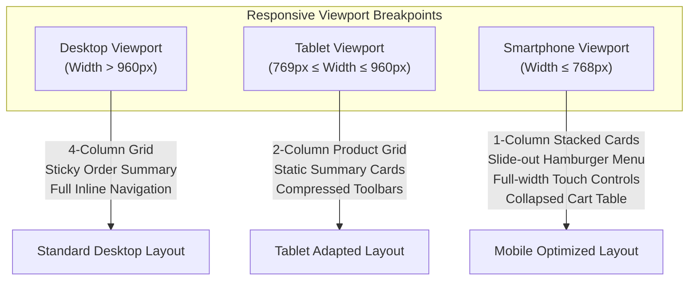

# Customer Storefront Prototype Documentation
**Project:** Zazen Matcha & Tea Co. — e-Commerce Platform  
**Course:** Eduvos ITECA3-34 Web Development and e-Commerce Technologies (Deliverable 2)  
**Deliverable Component:** Main Customer Website Prototype (6 Marks)  
**Location:** `docs/prototypes/customer/`

---

## 1. Prototype Overview & Target Audience

The Zazen Matcha customer storefront prototype establishes the visual language, information hierarchy, and user experience (UX) for a premium, single-origin Japanese matcha and teaware e-commerce platform.

### Target Audience & User Personas:
1. **Daily Ritual Drinkers:** Experienced matcha consumers seeking authentic, stone-ground ceremonial tencha from Uji, Kyoto, who prioritize grade transparency, harvest freshness, and reliable recurring supply.
2. **Mindful Wellness Novices:** Health-conscious individuals seeking sustained focus and calm energy (L-theanine + caffeine) as a clean alternative to coffee, requiring educational guidance on grade selection, water temperatures, and preparation.
3. **Culinary & Teaware Enthusiasts:** Shoppers looking for organic culinary powder for lattes and baking, or handcrafted Japanese teaware (wide-base ceramic chawan bowls, 80-tine bamboo chasen whisks, chashaku scoops) for gifting.

---

## 2. Screen Inventory & Pre-Development Mockup Mapping

The pre-development customer prototype was designed across four foundational desktop views. These assets have been verified, curated, and placed in this directory:

| Prototype File | Pre-Development Screen | Primary Design Concept & Components Illustrated |
| :--- | :--- | :--- |
| [`01-home-page-prototype.jpg`](01-home-page-prototype.jpg) | **Screen 01: Storefront Homepage** | Editorial hero banner (*"Mindful Matcha. Every Day."*), primary call-to-action buttons (*"Shop Matcha"*, *"Explore Our Story"*), three-pillar value proposition grid (*100% Ceremonial Grade*, *Mindfully Sourced*, *Calm Sustained Energy*), *Shop Our Favorites* preview, visual category cards (*Matcha Tea*, *Kits & Starter Sets*, *Ware & Accessories*), Uji origin story section, and dark footer with newsletter sign-up preview. |
| [`02-shop-catalog-prototype.png`](02-shop-catalog-prototype.png) | **Screen 02: Shop / Product Catalog** | Catalog banner (*"The Shop"*), horizontal category filter pills (*All Products*, *Ceremonial Matcha*, *Everyday Matcha*, *Kits & Starter Sets*, *Teaware & Accessories*), search input, sorting dropdown (*Sort by: Featured*), responsive 4-column product grid with star ratings, ZAR pricing, quick add-to-cart buttons, and numbered pagination controls. |
| [`03-product-details-prototype.png`](03-product-details-prototype.png) | **Screen 03: Product Details & Ritual Guide** | Hierarchical breadcrumbs (`Home / Shop / Matcha Tea / Ceremonial Matcha`), high-resolution product photography gallery with 3 selectable thumbnail views, product title, verified customer review rating (124 reviews, 5.0 stars), ZAR price, inline quantity stepper (`- 1 +`), dual purchase buttons (*Add to Cart*, *Buy Now*), expandable accordions (*Ingredients*, *Preparation Ritual*, *Shipping*), and related product recommendations strip. |
| [`04-shopping-cart-prototype.png`](04-shopping-cart-prototype.png) | **Screen 04: Shopping Cart Page** | Tabular item list displaying thumbnail, product title, variant notes, unit price, interactive quantity stepper, line total, and item removal action (`Remove X`). Floating order summary card displaying Subtotal, Estimated Shipping (R 0.00 standard), promo code input with *Apply* button, primary *Proceed to Checkout* button, and trust badges (guarantee, packaging, delivery). |

---

## 3. Core Functional & Interaction Concepts

### 3.1 Product Discovery & Navigation
* **Global Header:** Minimal, distraction-free navigation bar featuring brand typography, clean text links (*Home*, *Shop*, *About*, *Contact*), search trigger, customer account shortcut, and an active shopping cart pill reflecting real-time item count.
* **Faceted Category Filtering:** Interactive category pills allow shoppers to filter catalog listings instantly without full page reloads, transitioning smoothly between teas, accessories, and curated starter kits.
* **Search Integration:** Real-time search query input (`?search=`) allows keyword matching against product names and descriptions.

### 3.2 Product Details & Sourcing Education
* **Multi-Angle Visual Gallery:** Main stage imagery supplemented by interactive thumbnail buttons allowing consumers to inspect the stone-milled powder texture, the whipped froth consistency in a chawan bowl, and the exterior packaging.
* **Brewing Ritual Guidance:** Detailed preparation instructions (water temperature at 75°C–80°C, 1g–2g sifted powder, vigorous W-motion whisking) integrated directly beside purchasing controls to reduce purchase hesitation for beginner buyers.

### 3.3 Shopping Cart & Checkout Transition
* **Authoritative Price & Stock Revalidation:** Conceptual design requires the cart to verify live database stock before allowing quantity increases, preventing overselling.
* **Frictionless Checkout Journey:** A streamlined one-page checkout flow capturing customer contact details, delivery address across all nine South African provinces, and simulated payment methods (`Simulated Card` with instant verification or `Bank Transfer (EFT)` with reference instructions).

---

## 4. Multi-Device Responsive Architecture

While the original supplied design mockups focused on the desktop presentation, the application's responsive behavior was planned and codified in [`css/style.css`](file:///c:/xampp/htdocs/ZAZEN-MATCHA/css/style.css) across three distinct form factors:

### 4.1 Desktop Viewport (> 960px)
* Generous whitespace and maximum container width of 1200px.
* 4-column product grid (`.shop-product-grid`) displaying comprehensive card metadata.
* Two-column split layouts for checkout and cart, featuring sticky order summary sidebars.
* Full horizontal navigation bar with accessible hover and keyboard focus indicators.

### 4.2 Tablet Viewport (769px to 960px)
* Grid columns collapse to 2 columns for product catalogs and value proposition cards (`@media (max-width: 960px)`).
* Cart and checkout layouts transition from side-by-side splits to stacked vertical blocks.
* Fixed sticky sidebars revert to static positioning to prevent vertical viewport clipping on touch screens.

### 4.3 Smartphone Viewport (≤ 768px)
* Header navigation collapses into a dedicated mobile hamburger button (`#nav-toggle`) controlling an accessible slide-down drawer (`.nav-wrapper.is-open`) with animated toggle bars (`@media (max-width: 768px)`).
* Product cards render in a single full-width column, prioritizing large touch targets for image galleries and add-to-cart buttons.
* Cart tables hide column headers (`.cart-table-head { display: none; }`) and convert individual item rows into stacked vertical cards with touch-friendly quantity steppers.
* Form fields (shipping address, payment selection) span 100% viewport width with minimum 44px touch targets.

---

## 5. Prototype Gap Analysis

1. **Unrepresented Mobile / Tablet Mockups:**
   * The original pre-development design assets supplied for the project only included desktop wireframes (`01-home-page-prototype.jpg`, `02-shop-catalog-prototype.png`, `03-product-details-prototype.png`, `04-shopping-cart-prototype.png`).
   * Mobile and tablet layouts were not provided as separate graphical mockups; their behavior was designed directly in code via responsive CSS media queries.
2. **Unrepresented Checkout Screen Mockup:**
   * No standalone graphical mockup was provided for the checkout form. The checkout page was implemented directly from the design tokens and layout conventions established in the Shopping Cart mockup.

---

## 6. Client Approval Status

* **Status:** **PENDING FORMAL CLIENT APPROVAL**
* **Verification Note:** The pre-development customer prototypes represent the initial design vision created for stakeholder review. In strict accordance with academic assessment integrity, no client sign-off has been fabricated or assumed.
* **Next Action:** Formal client approval must be recorded using the standardized template in [`docs/prototypes/client-approval-template.md`](../client-approval-template.md).
